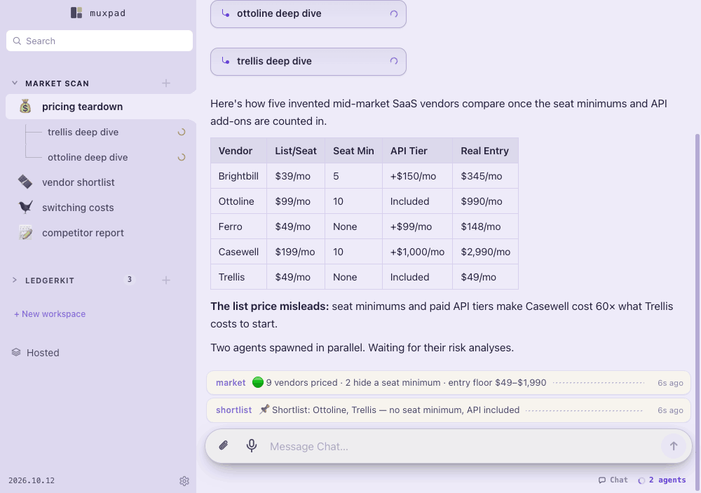
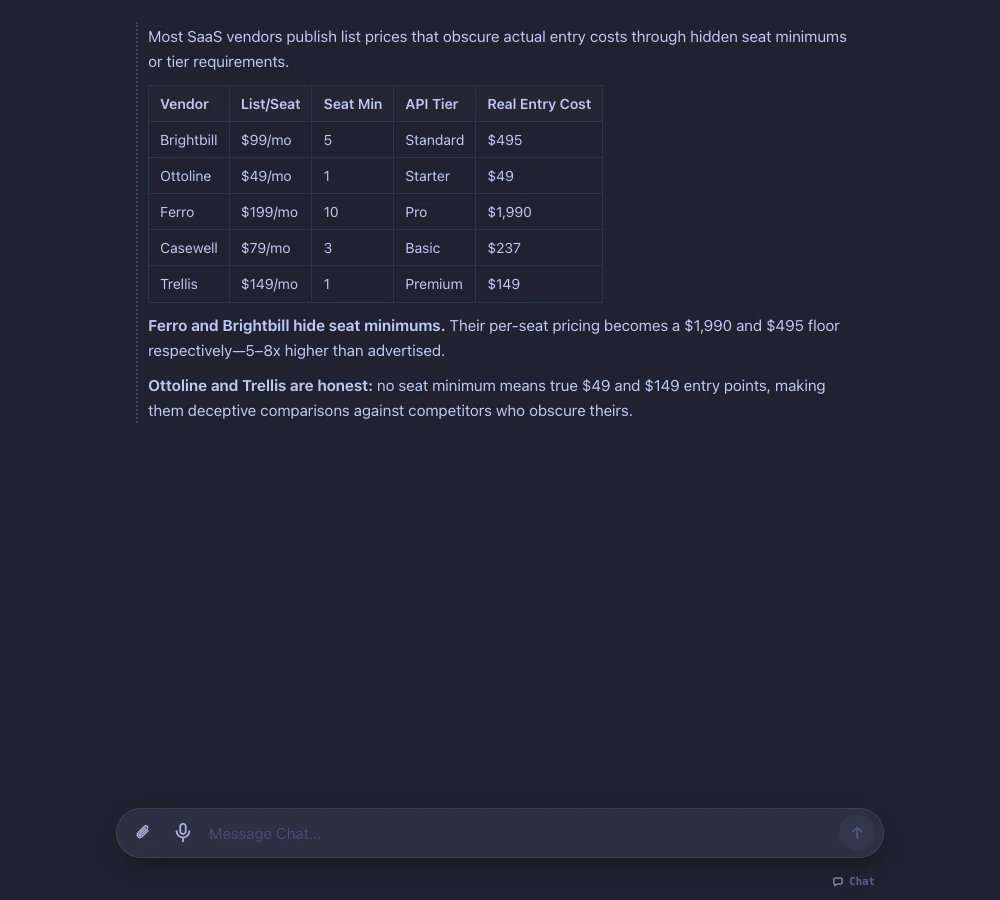
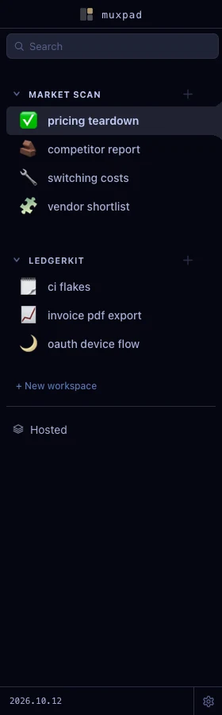

<p align="center">
  
</p>

<h1 align="center">muxpad</h1>

<h3 align="center">A browser-based cockpit for terminals and agents, on a box you keep around.</h3>

<p align="center">
  <a href="https://github.com/ohadpr/muxpad/actions/workflows/ci.yml"></a>
  
  
  
</p>

A pane is a shell, a web page, or a chat with an agent. The PTYs and the agent sessions live on the **server**, so you can shut the laptop, pick it up on your phone, and find the same session still running.

Half of what runs in here is a codebase. The other half is a market scan, a launch plan, a vendor decision — same panes, same status model, same phone.

One person, one machine. No auth, no accounts, no multi-tenancy.

<p align="center">
  
</p>

<table align="center">
<tr><td>

**Jump to** &nbsp;
[Concepts](#concepts) ·
[Agents](#agents) ·
[Workspace rules](#what-a-workspace-tells-its-agents-and-what-it-lets-them-do) ·
[Cards](#pinned-cards) ·
[Status](#status-one-word-per-pane) ·
[Publishing](#publishing-something-someone-else-can-open) ·
[Scheduling](#scheduling) ·
[Mobile](#mobile) ·
[Install](#install) ·
[**Trust model**](#trust-model) ·
[CLI](#the-muxpad-cli) ·
[Architecture](#architecture)

</td></tr>
</table>

## Concepts

Three nested containers:

- **Workspace.** Top-level, at `/w/:slug`. One workspace per browser tab is the typical pattern.
- **Tab.** Inside a workspace, a single mosaic layout. Tabs render either as a split mosaic or as a strip of pane-tabs.
- **Pane.** A leaf of the mosaic. A pane is `shell` (a PTY on the host) or `url` (an iframe), and it shows one of three **faces**: `terminal`, `web`, or `chat`. A shell pane running an agent can be flipped between its terminal face (the runner's activity log) and its chat face (the conversation) in place.

A chat opens at the newest message and pages history in as you scroll up, bounded — a long conversation never drags its whole transcript into the page, and rows you cannot see cost no layout. Opening at the bottom rather than at a restored pixel offset is deliberate: a semantic anchor costs one fetch and a geometric one costs as many as it takes to find.

Multiple browser tabs or devices can attach to the same workspace, or the same pane, simultaneously and stay in sync. Tabs can be dragged between workspaces, and a pane can be pulled out into a tab of its own — with an undo toast, because both are easy to do by accident.


## Agents

A pane can hold a **chat-native agent session** — rendered as HTML, not a TUI in a terminal grid. Three backends, one UI: `claude` (the Claude Agent SDK), `codex` (`codex exec`) and `cursor` (`cursor-agent`). The transcript, tool rows, model chip and composer are the same whichever is driving.


<p align="center">
  
</p>

- **Universal instructions.** `~/.muxpad/agent-instructions.md` is rewritten on every boot and injected into every session on every backend, so an agent knows muxpad exists and can drive it. Your own standing notes go in `agent-notes.md`, which muxpad creates once and never touches.
- **Two modes.** *Agent mode* is the harness as it ships. *Chat mode* adds a short house contract and hides the scratchpad — only what the agent deliberately says reaches you.
- **Questions come back as chips** (claude backend only). `ask_user` is registered by the Claude backend alone — `codex` and `cursor` expose no question tool — and an agent that calls it parks the pane in `blocked` and renders tappable options. Answering resolves the blocked tool call.
- **Background subagents are tracked.** The roster is server-owned, and an entry leaves when its subagent reports done or its runner dies, not on a decay timer — because a background subagent can sit silent in one tool call for a minute while plainly alive. It lives in memory on the runner's connection (bounded, oldest evicted), so unlike the session itself it does not survive a main-server restart.
- **A terminal Claude session can be adopted.** `muxpad claude [args…]` launches the real CLI in a pane, passes your flags straight through, and registers the session so the same conversation can be read and driven from the web chat.


Nothing about any of that is specific to code. The question above is a shipping contract; the agent that asked it has never opened a file in a repo.

## What a workspace tells its agents, and what it lets them do

Every agent in a workspace is handed muxpad's own instructions plus whatever
that workspace adds — house conventions, where things live, what never to point
at prod. Free text, edited from the workspace row's settings button, picked up
when a pane launches. The CLI reads and writes it too (`muxpad workspace
instructions <id>`), because an agent maintaining its own workspace's notes is
the point.

**Capabilities are the other half, and they are not the same kind of thing.**
A capability is off until you switch it on, and a capability that is off is not
merely refused at the call — the whole section is stripped from the
instructions, so an agent is never told about a tool it cannot use. Advertising
something to exactly the contexts that must never have it is how an agent comes
to attempt it.

Slack is the first one. A workspace with it off cannot read, search or post —
not just post, because a chat full of personal files listing every private
channel in the company is the same leak pointed the other way.

Three things make that hold rather than merely ask:

- **The credential never leaves the server.** It used to be a line in a dotfile
  that the CLI sourced into whichever pane asked, so a refused chat could read
  it and call Slack directly. `muxpad slack` is a thin client now; the token
  lives in `~/.muxpad/secrets.json`, written `0600` and refused on read if it is
  not `0600` any more.
- **The caller cannot just say who it is.** `$MUXPAD_PANE_ID` is a value any
  caller can set, so beside it every pane gets `$MUXPAD_PANE_KEY` — minted by
  the server for that pane and handed over in its spawn environment. Naming
  somebody else's pane does not get past the key, and a `cd` is worth nothing
  either way. A pane started before keys existed has none and fails closed;
  using Slack from it costs a restart of that pane.
- **An agent cannot grant itself anything.** The switch and the credential are
  both browser-only — the server refuses either change on a request with no
  `Origin` header, which the CLI and the agent runner never send.

Honest about the limits, of which there are two. The key is a bearer token: it
sits in a pane's environment, so anything that prints its environment into a
transcript puts it somewhere another pane can read. And everything here runs as
one uid, so none of it stops a process that is actively trying. It stops a
*helpful* agent reaching for a tool in arm's reach, which is the thing that
actually goes wrong. The airtight version is a broker under a second OS user.

(The first design proved identity by walking the caller's process ancestry,
which cannot be forged at all. It needed pane pids — a fact only the pty daemon
has — and reaching them meant a protocol change, which restarts the daemon that
owns every terminal on the machine. Not a price worth paying to beat an
accident.)

## Pinned cards

A chat can hold **named blocks pinned above the composer** — the current value of something, where the transcript is its history.

```bash
muxpad card set market "🔴 −0.61% · stocks -0.36% vs SPY -0.24% · ✅ no action" --every=1d
muxpad card set build --format=html < status.html
muxpad card list
muxpad card clear market
```

Setting the same name **replaces** it, which is the whole point: a card is an answer, not a log. `--every` declares how often you intend to rewrite it, and muxpad marks the card **overdue** when you stop — the failure nobody notices otherwise.

A card is one row: a dotted leader runs from the value to its age, the dots drift slowly toward it like tape through a machine, and their colour fades across the declared cadence so freshness is readable without being read. An `html` card renders in a sandboxed frame with no `allow-same-origin`, so agent-written markup cannot reach muxpad; the frame measures itself and posts its height out, because a parent cannot measure a frame it is isolated from.

**A card is also a destination.** `muxpad cron new --card=<name>` says a schedule's output goes *there* rather than into the conversation — so a fire that updates its card and says nothing renders nothing at all: no chip, no fold. The card's own freshness is the "did it run" signal, and anything the agent actually says (an error, a refusal) breaks the silence and brings the row back. That is the difference between a quiet job and an invisible one.

## Status: one word per pane

Every pane has exactly one status, and it is computed on the server:

| | |
|---|---|
| `blocked` | wants you **now** — an open agent question, or a pane that rang BEL |
| `working` | a turn is in flight, or the subagent roster is non-empty |
| `dead` | the runner exhausted its restarts and gave up |
| `ready` | finished, unread — waiting for you |
| `idle` | nothing to say |

The five are mutually exclusive and ranked in that order. A tab takes the highest-precedence status of its panes; a workspace takes the highest across every pane in every tab, computed whether or not it is expanded — so a collapsed workspace still tells you something is running inside it.

The rail shows it as a 10px mark per row, and rolls it up to the workspace when a group is collapsed — so an agent working somewhere you cannot see still says so.

<p align="center">
  
</p>

Two honest caveats. For a pane with **no** agent runner attached, `working` is still the old PTY-output heuristic — a `tail -f` will light it. And `working` deliberately stays true while a background subagent outlives the turn that launched it, so "is *this turn* finished?" is `muxpad agent wait`, not `working`.

The point of all of it is the loop below: a question arrives in a workspace you are not looking at, the collapsed row goes red, you follow it, you answer with one tap, and the pane leaves `blocked` on its own.


### Headlines and icons

Each row also carries a machine-written **headline** and an emoji, both derived from the conversation. They live in the row’s tooltip and the `@` picker now: on the rail itself a second line of dim text made the list a paragraph to read rather than a column to scan.

## Memory, and things that outlive a tab

- **`muxpad search`** — every session is mirrored to `~/.muxpad/archive/` and indexed in SQLite **FTS5**, including sessions muxpad never launched. Append-only: a `/compact` seals the old mirror rather than overwriting it. CLI only.
- **Chats that nobody is using stop costing anything.** A conversation untouched for three days (or a retired sub-chat after an hour) has its process stopped, and the next message, cron fire or open starts it again. Nothing is lost: the conversation is on disk and the model API is stateless, so a resident process buys no warm context — a revival costs a couple of seconds of boot. Measured on one machine: 124 runners and 15.2 GB down to 21 and 3.3 GB.
- **`muxpad app`** — a long-running local web server muxpad keeps alive with no tab of its own. An app is a supervised pane in a hidden workspace: ptyd owns the process, so it survives a main-server restart; the command restarts on crash; the state you see is *measured* (`starting`, `running`, `unreachable`, `stopped`, `gave up`), not assumed.

## Publishing something someone else can open

An agent that produced a thing — a report, a comparison, a brief — can put it on a URL and hand you the link, without you moving files anywhere.

```bash
muxpad publish ./report --name=market-teardown   # → https://…/market-teardown/
muxpad publish ./chart.html                      # unnamed: a random 8-hex slug
muxpad publish --update=market-teardown ./report # replace in place, same link
muxpad publish --list                            # slug, files, bytes, versions
```

`publish` copies the file or directory into `~/.muxpad/public/` and prints the URL. **Republishing a named slug keeps the URL**: the previous copy rotates to `/<slug>@2/`, `@2` to `@3`, and the three most recent previous versions stay live — so the link already sitting in someone's inbox shows the new numbers, and the version you sent last month is still there to diff against. `--update=` refuses to *create*, which is the guard against accumulating near-identical slugs.


**What the link is:** a real public URL on a *second* listener, on its own port — the one `tailscale funnel` points at, so the funnel never touches the UI. Anyone with the link can open it, no tailnet, no account. The access control is an unguessable slug, and a named slug is a URL you chose to hand out: publishing something publishes it, so check the directory first.

**What the link is not:** it is not your muxpad. The artifact listener carries no API, no WebSocket and no directory listings, its root deliberately 404s, and every response is sandboxed by CSP *without* `allow-same-origin` so one artifact cannot read another's storage. And **apps are never exposed this way** — muxpad only ever funnels `~/.muxpad/public/`.

> **`publish` turns the funnel on for you.** The listener binds loopback, but if `tailscale` is on the PATH the first `muxpad publish` runs `tailscale funnel --bg --https=8443` against it — no prompt. With no tailscale it prints the loopback link and warns on **stderr** that it only works on this machine; the link itself looks fine, so take the warning seriously.


Apps and artifacts surface together at **`/hosted`**, because "what am I hosting and is it up?" spans them — and separately, because an app can be stopped and an artifact cannot, and an artifact has a link worth copying and an app deliberately does not. Opening an app is a route, not a tab: closing it never touches the process.


## Scheduling

`muxpad cron` is a durable, server-owned scheduler — one interval over persisted rows, not N in-memory timers.

```bash
muxpad cron new --name=pr-sweep --at='weekdays at 09:00' --new-tab \
  "check my open PRs and summarise what needs me"
muxpad cron new --name=price-watch --at='mon at 07:00' --new-tab \
  "re-read the nine pricing pages and tell me only what changed"
muxpad cron run pr-sweep     # fire it now; test before you trust it
muxpad cron list             # schedule, next due, last run, failure streak
```

`--at` takes a cron expression or a phrase (`daily at 09:00`, `every 30m`); `--tz` pins an IANA zone. `--card=<name>` declares where the output belongs (see [Pinned cards](#pinned-cards)).

**A schedule's turn is machinery, and the fire says what it means to say.** Everything a fire does folds into its collapsed run — the injected prompt (an instruction a schedule handed the agent is never something a person said), the tool calls, and the prose the model produced on the way to being finished. The one exception is `muxpad say "…"`, which renders as a message:

```bash
muxpad cron new --name=net-watch --at='weekdays at 16:20' --pane \
  "Check NET. If it closed below \$325, run muxpad say with the price, the
   percentage from here and the ticket. Otherwise do nothing and say nothing."
```

This is the same rule Chat mode has always applied to any turn a human did not start, and `say` is the same escape hatch Chat mode's `reply` tool provides — reached through the CLI because Agent mode registers no muxpad tools.

The axis matters more than it looks. Two earlier versions put the switch on the *schedule* (`--silent`, then `--speak`), and a schedule cannot answer the question: a watcher that is silent unless a trigger fires is quiet on almost every run and has the most important thing to say on one of them. Only the fire knows. (Those flags are still accepted and ignored.)

`say` works outside crons too — it is "address the person", and carries a per-install key so output that merely *mentions* the marker is not mistaken for an invocation of it.

The reason this exists rather than leaning on a harness's own scheduler: those fire inside one session's context, expire after about a week, lose every fire that came due while the machine was asleep, and are invisible from anywhere else. muxpad's is in SQLite, never expires, and is editable from any pane.

## Driving muxpad from inside muxpad

The `muxpad` CLI is on the PATH inside every pane the daemon spawns, and picks up the current workspace / tab / pane from `MUXPAD_WORKSPACE_ID`, `MUXPAD_TAB_ID`, `MUXPAD_PANE_ID`. That makes an agent in one pane able to see and drive the others:

```bash
muxpad pane list --all                 # id, workspace/tab, face, status, title
muxpad pane read <id> --lines=200       # a terminal's scrollback, ANSI-stripped
muxpad pane send <id> "pnpm test"       # type into a live pty
muxpad pane summarize <id>              # a short summary instead of a transcript

muxpad agent send <paneId> "…"          # deliver a message; queues if mid-turn
muxpad agent wait <paneId> --timeout=600 # block until that turn ends
muxpad agent transcript <paneId> --tail=40

muxpad watch --types=agent_turn         # stream the event bus, one line per event
```

`agent wait` is the load-bearing one: run it in the background and a supervising agent gets woken when its worker finishes, instead of polling. Messages sent to a busy agent land in a **server-side** queue and drain on turn-done, so a batch runs to completion with no browser open.

## Mobile

muxpad runs on phones — iOS Safari and Chrome on Android. The mobile story is two halves and it only works with both: **see what needs you**, and **answer it from there**.

The navigator is the same state rail in a panel that drops down from the chrome bar, so "what wants me?" is one tap from anywhere — including from workspaces you have collapsed. Open the row and you get the full conversation and a real composer, so a decision that arrived while you were out is a decision you can actually make.


On a terminal pane a **tap** goes through to the TUI, a **drag** scrolls the scrollback, and **two fingers** always scroll.

Mobile is for checking in on a session you started elsewhere. Long sessions still want a real keyboard.

## Everything else that survived from v1

- One PTY per shell pane via `node-pty`; several browser tabs or devices can attach to the same pane and see the same output.
- Pane titles track the foreground program: the OSC 0/1/2 title if the program sets one, otherwise the foreground command from the controlling tty.
- Image paste: a screenshot from your clipboard becomes a file on disk and the path is typed into the PTY, so Claude Code reads it as an attachment.
- OSC 52 writes from TUIs land on the system clipboard. Cmd/Ctrl+C copies a terminal selection.
- Structural state (workspaces, layouts, pane specs) lives in SQLite. Shells survive a main-server restart untouched. A `ptyd` restart kills PTYs; they respawn at the last-known cwd, which is polled every 30s.
- Pop a single pane to its own URL at `/p/:paneId` for a second monitor or an OBS scene.
- "Open this URL in a real browser tab" surfaces as a click-to-open toast, so popup blockers don't eat it.
- Five themes (three dark, two light) and a curated monospace font picker.


## Requirements

- macOS or Linux (the cwd-tracking path uses `lsof`)
- Node 22+
- pnpm 10+ (`corepack enable && corepack prepare pnpm@10.30.1 --activate`, or `brew install pnpm`)
- `curl` and `jq` — effectively every HTTP verb of the `muxpad` CLI needs them (`muxpad claude` is the one that parses its response without `jq`), so the whole "drive muxpad from inside muxpad" section is dead without `jq`

Agent panes need `codex` and/or `cursor-agent` on the PATH if you intend to use those backends. The **claude** backend does not need anything on the PATH — it runs through `@anthropic-ai/claude-agent-sdk`, which brings its own binary and uses your existing login. A PATH `claude` is needed only for `muxpad claude`, the TUI adoption path.

## Install

```bash
corepack enable && corepack prepare pnpm@10.30.1 --activate   # match the pinned pnpm
pnpm install
MUXPAD_HOST=127.0.0.1 pnpm serve   # build if needed, start in background, print the URL
pnpm serve:status     # state, URL, log path
pnpm serve:logs       # tail the log
pnpm serve:stop       # stop the main server (add --all for ptyd too)
pnpm serve:restart    # stop + start (after pulling)
```

> **Set `MUXPAD_HOST`.** `pnpm serve` resolves the bind address itself: `MUXPAD_HOST` if you set it, else `tailscale ip -4`, else — and this is the one to watch — **`0.0.0.0`**. On a machine with Tailscale that lands on your tailnet IP, which is the intended setup. On a machine without it, an unset `MUXPAD_HOST` binds every interface on a server with no authentication. (`127.0.0.1` is the default only when you run `node server/dist/index.js` directly.)

Logs go to `~/.muxpad/server.log` and `~/.muxpad/ptyd.log`. For auto-start on reboot, install the two launchd jobs in [docs/launchd.md](docs/launchd.md) — the CLI detects them and routes `start`/`stop`/`restart` through `launchctl` rather than spawning a second daemon to fight over the port.

`stop` and `restart` leave ptyd alone by default; `--all` includes it, **which kills every pane**.

`/` has no page of its own: it sends you to your first workspace, or — if you have none — creates one with a starter tab and shell pane and drops you in it. The state rail is the overview: the persistent sidebar on desktop (there is no top bar once you are inside a workspace), the drop-down navigator on mobile. Split the pane from its chrome, or with `muxpad pane new --cmd=…` from inside it.

### Troubleshooting

- **`pnpm build` fails with `Cannot find module '@muxpad/shared'`** — a stale `tsconfig.tsbuildinfo` cache is out of sync with a removed/incomplete `dist/`, so `tsc -b` thinks it's already built and skips emitting. Run `pnpm clean && pnpm build`. (`pnpm serve` self-heals this whenever it rebuilds a missing `dist`.)

## Trust model

Read this section before you point it at anything.

**There is no authentication.** Reachability is authorization. Bind to an interface you actually trust — typically your Tailscale IPv4 — and never to `0.0.0.0` on an unfiltered network. Anyone who can reach the port can open a WebSocket into a live shell. Note that `pnpm serve` falls back to `0.0.0.0` when there is no `MUXPAD_HOST` and no Tailscale; set it explicitly.

**A workspace's capabilities are a boundary against mistakes, not against malice.** See [capabilities](#what-a-workspace-tells-its-agents-and-what-it-lets-them-do). Credentials live in the server process and are identified by process ancestry rather than by anything the caller says, which is enough to stop an agent wandering into a tool it should not have. It is not a sandbox: same uid, same home directory, same everything.

**Artifacts are public on purpose.** The listener is a *second* one on its own port — no API, no WebSocket, no directory listings. Access control is an unguessable slug, and a named slug is a URL you chose to hand out. Publishing something publishes it; check the directory first.

One practical wrinkle: `tailscale funnel` puts the artifact listener on **:8443**, and plenty of real networks block outbound to non-standard HTTPS ports — so a discovered funnel link works for you and fails for the person you sent it to. That is what `MUXPAD_PUBLIC_BASE_URL` (a permanent domain) and `muxpad publish --set-base` (an ephemeral tunnel on :443) are for; `publish --base` shows which origin links are currently built from and whether it is answering.

**Apps are not.** muxpad never funnels an app; only `~/.muxpad/public/` is ever exposed. But that is a statement about muxpad's own surfaces, not a sandbox around the app's process: an app binds wherever its own command binds it, and muxpad does not enforce loopback on your behalf.

Every environment variable, and the voice-mode spend caps, are in **[docs/configuration.md](docs/configuration.md)**.

### Optional: nicer URL via Tailscale Serve

To reach muxpad at `https://<your-machine>.<tailnet>.ts.net/` (no port, Tailscale-issued cert):

```bash
pnpm serve:public         # start + map via tailscale serve in one step
pnpm serve:stop --all     # the mapping only comes down on a full stop
```

That sets `MUXPAD_TAILSCALE_SERVE=1` so the daemon's only public face is the cert. A plain `stop` (and therefore a plain `restart`) deliberately leaves the mapping up, so a routine restart doesn't give everyone on the tailnet a 4xx blip. Status / manual control via `tailscale serve status` / `tailscale serve reset`.

## The `muxpad` CLI

```bash
# Split a sibling pane to the right, running `pnpm dev`
muxpad pane new --cmd='pnpm dev'

# Split below this pane and tail a log
muxpad pane new --direction=below --cmd='tail -f app.log'

# Add a dashboard as an iframe pane to the right
muxpad pane open https://grafana.internal

# Start a new agent tab already working on something, print its URL
muxpad agent new --name='vat rules' "audit the eu-vat rule table for gaps"

# Same verb, no code involved
muxpad agent new --name='returns quotes' "compare the two returns quotes on total cost"

# Read, search and post in Slack — always as you, 🤖-prefixed, off by default
muxpad slack read '#eng' --since=2h
muxpad slack post @teammate "the PR feedback"
#   → refuses unless this chat's WORKSPACE has Slack switched on in the UI, so a
#     personal chat can never read or message a work surface. This command holds
#     no credential: the server does, and it works out which workspace you are
#     in from your process ancestry — so neither `cd` nor MUXPAD_PANE_ID nor
#     MUXPAD_WORKSPACE_ID can talk it round, and the switch cannot be thrown
#     from the CLI, because the CLI is what agents drive.

# Per-workspace agent instructions (readable AND writable from a chat)
muxpad workspace instructions <id>                  # print
muxpad workspace instructions <id> - < notes.md     # replace
muxpad workspace caps <id>                          # read-only; UI changes them

# Put a finished thing on a URL and print the link
muxpad publish ./report --name=market-teardown

# Run a dev server in THIS pane under supervision, with a web face
muxpad serve --url=http://localhost:4321 --label=Notes -- ./start
```

Every `new` command prints the created resource on stdout; `--json` prints raw JSON for `jq`. `muxpad --help` is the full surface — daemon control, workspace/tab/pane CRUD, `agent`, `cron`, `app`, `publish`, `search`, `watch`.

## Architecture

Two processes:

- `muxpad` (main) serves HTTP, the React bundle, structural state (SQLite), the WebSocket layer and the artifact listener. Proxies pane I/O through to ptyd.
- `ptyd` owns terminals. Long-lived. Speaks a small RPC protocol over `~/.muxpad/ptyd.sock`.

Agent sessions run in a third kind of process: one runner per agent pane, living in that pane's PTY, talking to the main server over `/ws/agent-runner/:paneId`. That is why an agent survives a main-server restart — the runner reconnects and re-announces its session.

The split is load-bearing: editing server code and watching it reload doesn't kill your running shells. Same for `muxpad restart` (without `--all`).

```
shared/   zod-validated domain types, chat-event model, WS binary protocol codecs
server/   Hono HTTP, ws, better-sqlite3, the agent runner + backends, cron, archive (main)
          and ptyd (node-pty)
web/      React + Vite + TanStack Router + xterm.js + react-mosaic-component
```

## Hack on it

CI runs five independent checks on every push — typecheck, lint, and the
shared / web / server suites. What they do and do not cover (they are
deliberately not a browser regression gate) is written up in
[`.github/ci.md`](.github/ci.md).

```bash
pnpm install
pnpm dev
```

Vite at `:5173` proxies API + WebSocket to the server on `:7777`. Note that `pnpm dev` is `vite --host`: it binds every interface. If you want an instance that cannot collide with your real one, give it its own port, its own `MUXPAD_DATA_DIR` and its own `MUXPAD_PTYD_SOCKET`.

## Not in scope right now

Open follow-ups: [docs/punch-list.md](docs/punch-list.md) and [docs/roadmap.md](docs/roadmap.md). Deliberately out:

- Auth. The tailnet boundary is the access boundary.
- Multi-user anything. No accounts, no sharing, no per-user state.
- A hosted/managed version. It is a thing you run on your own box.

## License

MIT. See [LICENSE](LICENSE).
